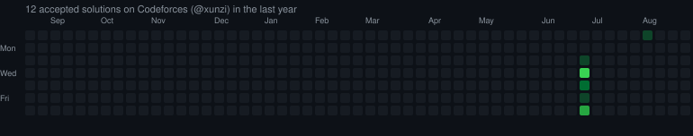

## Hi there, I'm Ayananta Paul,
B.Tech Student in Electronics and Computer Science Engineering. I am passionate about bridging the gap between hardware and software, exploring embedded systems, IoT, and Linux Kernel development.

## Codeforces Activity 

